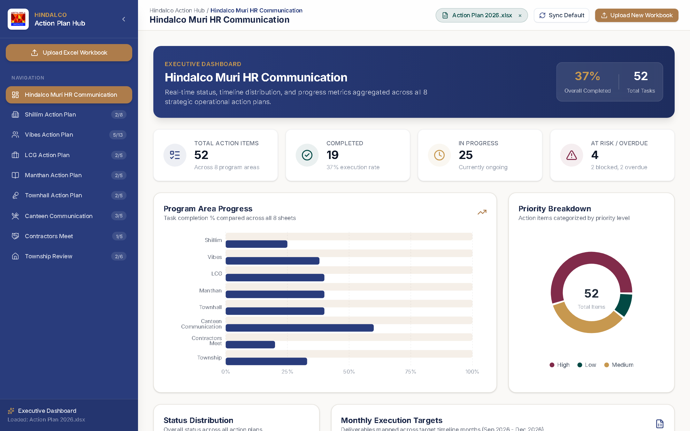
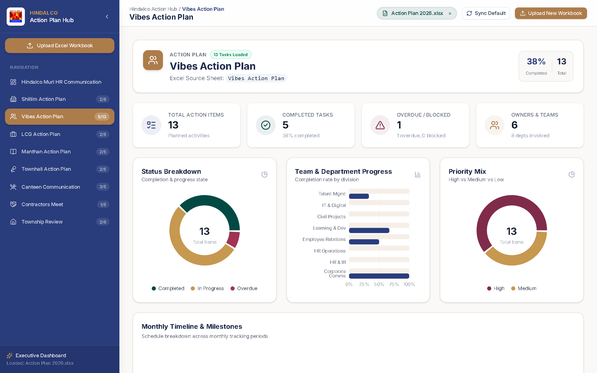
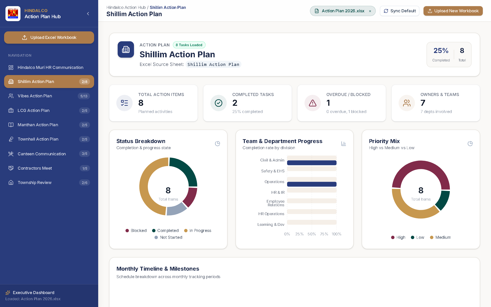
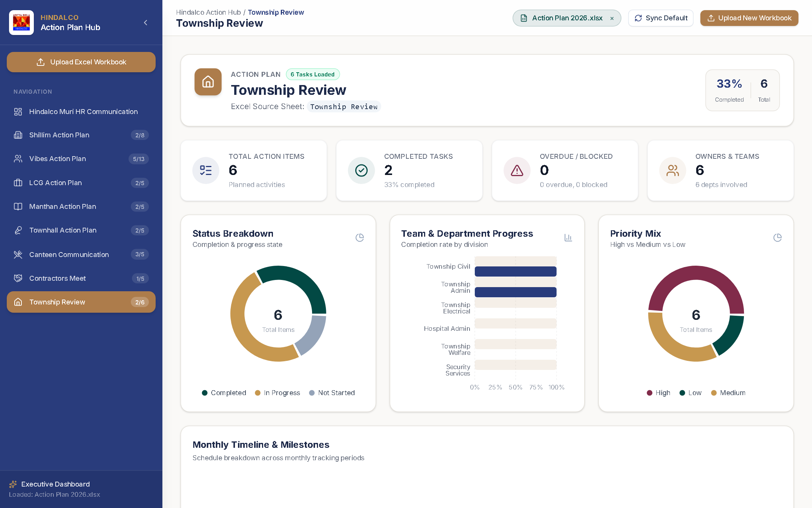

# 🏢 Aditya Birla Hindalco — Action Plan Executive Hub

A modern, responsive, executive-grade Action Plan Management and Visualization Dashboard built for **Aditya Birla Group (Hindalco Muri)**. The portal dynamically reads, parses, visualizes, and manages multi-sheet Excel workbooks across 8 strategic operational action plans.



---

## 🌟 Key Features

- **📊 Global Executive Overview (`/overview`)**:
  - Aggregated high-level KPI metrics across all sheets: Total Action Items, % Completed, In Progress, and At Risk / Overdue items.
  - **Cross-Sheet Progress Comparison**: Horizontal progress bar comparing completion percentage across all operational areas.
  - **Priority Breakdown**: High, Medium, and Low task distribution donut chart.
  - **Status Distribution**: Real-time completed, ongoing, blocked, and overdue categorization.
  - **Milestone Timeline**: Deliverables mapped across monthly milestones (Sep 2026 – Feb 2027).

- **📑 8 Dedicated Interactive Action Plan Views**:
  - `Shillim Action Plan`: Workplace hygiene, operational discipline, teamwork, and values pillars.
  - `Vibes Action Plan`: Onboarding rituals, managerial effectiveness, performance culture, development career, engagement index, and leadership.
  - `LCG Action Plan`: Joint consultation committee, statutory welfare, and worker safety.
  - `Manthan Action Plan`: Continuous improvement, Kaizen competition, energy conservation, and quality circles.
  - `Townhall Action Plan`: Quarterly open houses, employee recognition, shift connect, and action tracker closures.
  - `Canteen Communication`: Food safety audits, nutrition reviews, joint canteen committees, and QR meal feedback.
  - `Contractors Meet`: Contractor conclaves, statutory wage audits, biometric safety passes, and performance scorecards.
  - `Township Review`: Housing civil maintenance, drinking water chlorination, smart LED street lighting, hospital readiness, and club revamps.

- **⚡ Interactive Data Table (`@tanstack/react-table`)**:
  - Full-text search across topics, action descriptions, assignees, and departments.
  - Multi-select filters for **Status** (Completed, In Progress, Blocked, Overdue) and **Priority** (High, Medium, Low).
  - Sortable column headers with custom visual indicators.
  - Color-coded badges and inline completion progress bars.
  - Configurable pagination (10, 20, 30, 50 rows per page).
  - **One-Click Export**: Export filtered views directly to **Excel (`.xlsx`)** or **CSV (`.csv`)**.

- **📁 Dynamic Excel Loading & Drag-and-Drop**:
  - Bundled default dataset (`Action Plan 2026.xlsx` / `default_action_plan.xlsx`) loads automatically on first visit.
  - Drag-and-drop zone (`FileUploadZone`) to upload new workbooks at any time.
  - Multi-sheet parser automatically detects structured PM columns (`Status`, `Priority`, `Assignee`, `Due Date`, etc.) as well as topic/bullet formats.
  - Client-side persistence via `localStorage` preserves your session across page refreshes.

- **🎨 Royal Glimmer Theme & ABG Branding**:
  - Corporate palette: **Royal Blue (`#293C7C`)**, **Gold (`#AD7C4B`)**, **Light Gold (`#C7984F`)**, **Dark Teal (`#024944`)**, and **Burgundy (`#812B4A`)**.
  - Official Aditya Birla Hindalco company branding integrated across the sidebar, header, and favicon.

---

## 📸 Screenshots & UI Preview

### 1. Global Executive Overview
> High-level executive overview with aggregated KPI metrics, cross-sheet progress comparisons, priority distribution, and milestone timeline.


---

### 2. Vibes Action Plan View
> Dedicated interactive dashboard with topic metrics, team breakdown charts, and a filterable, sortable data table.



---

### 3. Shillim Action Plan View
> Workplace hygiene, operational discipline, and values pillar task tracking with real-time status badges and exports.



---

### 4. Township Review View
> Residential colony civil maintenance, healthcare readiness, and infrastructure action tracking.



---

## 🛠️ Tech Stack

| Technology | Purpose |
|---|---|
| **React 18** | Frontend library |
| **Vite** | Blazing-fast build tool & dev server |
| **TypeScript** | Type-safe code & data models |
| **Tailwind CSS v4** | Modern utility-first styling with custom theme tokens |
| **Recharts** | Interactive charts (Donut, Horizontal Bar, Stacked Bar) |
| **@tanstack/react-table v8** | Headless data table for sorting, filtering, and pagination |
| **SheetJS (`xlsx`)** | Client-side Excel workbook parsing and exporting |
| **Lucide React** | Clean, corporate iconography |
| **React Router v7** | Client-side routing for multi-page dashboard views |

---

## 🚀 Getting Started

### Prerequisites
- **Node.js** (v18.0 or higher recommended)
- **npm** or **pnpm**

### Installation

1. **Clone the repository**:
   ```bash
   git clone https://github.com/Priya776893/Action-Plan-Tracker-website-.git
   cd Action-Plan-Tracker-website-
   ```

2. **Install dependencies**:
   ```bash
   npm install
   ```

3. **Start the development server**:
   ```bash
   npm run dev
   ```

4. **Open in browser**:
   Navigate to [http://localhost:5173/](http://localhost:5173/) to view the application.

### Production Build

To create an optimized production bundle:
```bash
npm run build
npm run preview
```

---

## 📂 Project Structure

```
ACTION_PLAN_WEB/
├── docs/
│   └── images/                       # UI Screenshots for documentation
│       ├── global-overview.png
│       ├── vibes-action-plan.png
│       ├── shillim-action-plan.png
│       └── township-action-plan.png
├── public/
│   ├── company-logo.png              # Aditya Birla Hindalco official logo
│   └── default_action_plan.xlsx      # Bundled 8-sheet Excel workbook
├── src/
│   ├── components/
│   │   ├── dashboard/                # KPI cards, Pie/Donut charts, Bar & Timeline charts
│   │   │   ├── KpiCard.tsx
│   │   │   ├── PriorityDonut.tsx
│   │   │   ├── ProgressBarChart.tsx
│   │   │   ├── StatusPieChart.tsx
│   │   │   └── TimelineChart.tsx
│   │   ├── layout/                   # Branded Sidebar, Top Header, AppShell
│   │   │   ├── AppShell.tsx
│   │   │   ├── Header.tsx
│   │   │   └── Sidebar.tsx
│   │   ├── shared/                   # Empty states & upload banners
│   │   │   └── EmptyState.tsx
│   │   ├── table/                    # TanStack Table, Columns, Toolbar, and Export buttons
│   │   │   ├── DataTable.tsx
│   │   │   ├── ExportButton.tsx
│   │   │   ├── TableToolbar.tsx
│   │   │   └── columns.tsx
│   │   └── upload/                   # Drag-and-drop file upload zone
│   │       └── FileUploadZone.tsx
│   ├── context/
│   │   └── DataContext.tsx           # Global state, localStorage persistence & loader
│   ├── lib/
│   │   ├── constants.ts              # Royal Glimmer colors, sheet configurations
│   │   ├── excel-parser.ts           # Multi-sheet SheetJS parser
│   │   └── utils.ts                  # KPI math & formatting helpers
│   ├── pages/
│   │   ├── GlobalOverview.tsx        # Portfolio executive summary
│   │   └── SheetView.tsx             # Sheet-specific dashboard & table view
│   ├── types/
│   │   └── index.ts                  # TypeScript interfaces for ActionItem & SheetData
│   ├── App.tsx                       # React Router configuration
│   ├── index.css                     # Royal Glimmer Tailwind CSS variables
│   └── main.tsx                      # Application entry point
├── package.json
├── tsconfig.json
└── vite.config.ts
```

---

## 📄 License

This project is created for internal executive reporting and operational action plan tracking at **Aditya Birla Group (Hindalco Muri)**.
